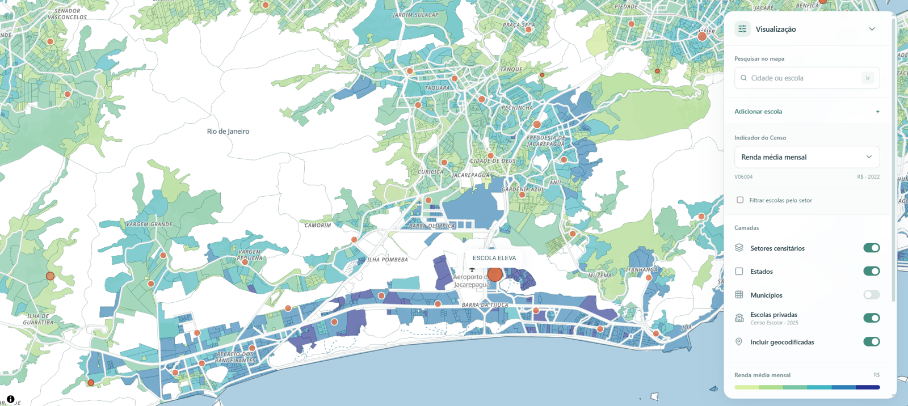
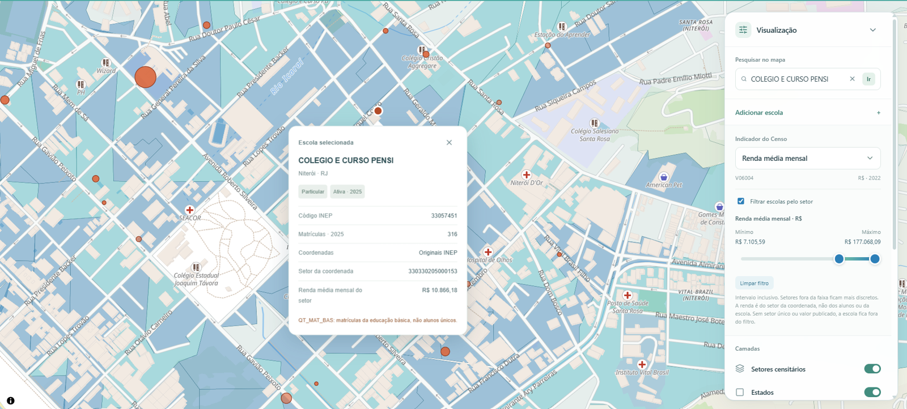
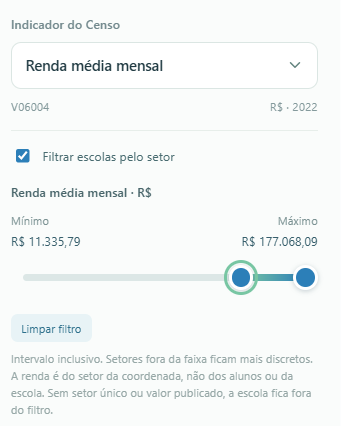
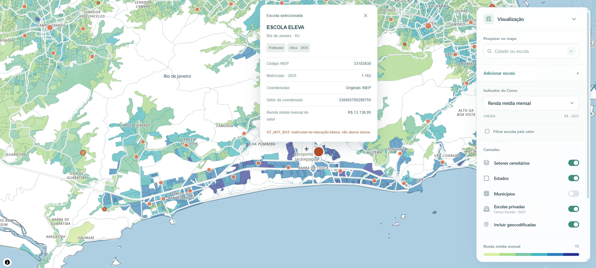

# 🗺️ Escolas Brasil

Mapa interativo de **468.099 setores do Censo 2022** e **31.053 escolas privadas
em atividade em 2025**, com busca por cidade ou escola e filtros por renda.

React, TypeScript, Vite, MapLibre GL e PMTiles. As geometrias são carregadas por
área e zoom; não é necessário banco de dados ou chave de API.



*Barra da Tijuca e Jacarepaguá, Rio de Janeiro.*

**[Funcionalidades](#-funcionalidades)** · **[Instalação](#-instalar-e-abrir)** ·
**[Dados e indicadores](#-dados-e-interpretação)** ·
**[Desenvolvimento](#-desenvolvimento-e-publicação)**

## ✨ Funcionalidades

### 🔎 Busca e navegação

No campo **Pesquisar no mapa**, digite o nome de uma cidade ou escola.
A busca aceita nomes sem acentos, combinações de nome, cidade e UF e filtros
por tipo de resultado. Clique em um resultado ou selecione pelo teclado e
pressione **Enter**:

- **Cidade:** o mapa enquadra os limites do município.
- **Escola:** o mapa aproxima a coordenada e abre o cartão de informações.

Arraste para navegar e use o scroll para ajustar o zoom. As siglas dos estados
dão lugar aos nomes dos municípios ao aproximar, mesmo com os contornos ocultos.



### 🎚️ Filtro por intervalo

1. Escolha o indicador no painel — por exemplo, **Renda média mensal**.
2. Marque **Filtrar escolas pelo setor**.
3. Arraste as **duas pontas do slider** para definir o intervalo desejado.
4. Use **Limpar filtro** para remover a restrição de intervalo.



O intervalo inclui os extremos e atualiza pontos, busca de escolas, agrupamentos,
totais de matrículas e contador. Setores fora da faixa ficam mais discretos.
Trocar de indicador redefine a faixa para o domínio completo. O slider aceita
ajustes pelo teclado e usa escala não linear para acomodar valores extremos.

> [!IMPORTANT]
> Com o filtro ativo, uma escola precisa estar associada a **um único setor**
> com valor publicado dentro do intervalo. Pontos sem associação, com associação
> ambígua ou com indicador ausente ficam fora do resultado.

### 🏫 Detalhes das escolas

Clique no círculo da escola para abrir o **pop-up** com nome, município/UF,
código INEP, matrículas de 2025, origem das coordenadas e, quando disponível,
setor e valor do indicador. Um seletor permite alternar entre escolas na mesma
coordenada.



A **área dos círculos** representa o total conhecido de matrículas da educação
básica (`QT_MAT_BAS`), não alunos distintos. Escolas sem esse total usam um
marcador de referência. Escolas próximas formam agrupamentos ao afastar o mapa;
clique neles para aproximar. Os agrupamentos somam matrículas conhecidas, com
escala própria e tamanho limitado.

### 🗂️ Indicadores e camadas

Escolha um dos [seis indicadores do Censo](#indicadores-disponíveis) e controle
a exibição de **setores censitários**, **estados**, **municípios** e **escolas
privadas**. **Incluir geocodificadas** controla os pontos com posição aproximada.

A legenda usa **verde para valores menores, azul para maiores e branco para
ausência de informação**. O preenchimento respeita os limites dos setores, sem
suavização, e fica mais transparente ao aproximar para facilitar a leitura das ruas.

### 📍 Cadastro manual e backup

Abra **Adicionar escola** e informe **nome, latitude e longitude**, em graus
decimais. O ponto passa a aparecer no mapa e na busca. Cadastros manuais não
recebem código INEP ou matrículas estimadas e podem ser excluídos individualmente.

Use **Exportar backup** para salvar os cadastros em JSON e **Importar backup**
para recuperá-los ou transferi-los para outro navegador ou computador.

> [!WARNING]
> Os cadastros manuais ficam **somente no navegador**, vinculados ao endereço
> e à porta da aplicação, sem sincronização. Exporte um backup antes de limpar
> os dados do navegador ou mudar de endereço.

## 🚀 Instalar e abrir

Requisitos: Git, **Node.js 22.12+ ou 24+**, npm, **Python 3.11+** e navegador com
WebGL. Reserve **2 GB livres** para instalar o pacote de dados de aproximadamente
**414 MB**. Internet é necessária para download e para a base Bright/OpenFreeMap.
O repositório e os dados são públicos; não é necessário login, token ou `.env`.

```sh
git clone https://github.com/GGregon/escolas-brasil.git
cd escolas-brasil
python scripts/baixar_dados.py
cd frontend
npm ci
npm run dev
```

Abra **http://127.0.0.1:5173/** e mantenha o terminal aberto. No Windows, após
instalar os dados, também é possível abrir `iniciar-mapa.cmd` com dois cliques.

O instalador baixa o pacote da [release dados-v1](https://github.com/GGregon/escolas-brasil/releases/tag/dados-v1)
e verifica tamanho e SHA-256 do ZIP e de cada arquivo antes da instalação.

Para instalar sem o download automático, baixe o ZIP pela página da release
e execute a partir da raiz:

```sh
python scripts/baixar_dados.py --arquivo "caminho/dados-mapa-v1.zip"
```

## 📊 Dados e interpretação

### Indicadores disponíveis

| Código | Indicador | Unidade |
| --- | --- | --- |
| `V06001` | Pessoas responsáveis por domicílios particulares permanentes ocupados | Pessoas |
| `V06002` | Moradores nesses domicílios | Moradores |
| `V06003` | Variância do número de moradores nesses domicílios | Moradores² |
| `V06004` | Rendimento nominal médio mensal dos responsáveis com rendimento | R$ |
| `V06005` | Variância desse rendimento | R$² |
| `V06006` | Rendimento nominal mediano mensal dos responsáveis com rendimento | R$ |

Os valores monetários são **nominais de 2022**. A renda média e a mediana
consideram os responsáveis **com rendimento**. As variâncias descrevem a
dispersão e têm unidades ao quadrado; não são valores de renda ou contagens.

### Fontes e cobertura

| Camada | Fonte e referência |
| --- | --- |
| Renda e domicílios por setor | IBGE, Censo 2022, agregados de 08/05/2026 |
| Setores, estados e municípios | Malhas de 2022; 27 UFs e 5.570 municípios |
| Cadastro escolar e matrículas | INEP, Censo Escolar 2025 V2 |
| Coordenadas das escolas | Ipea/geobr 2025, release v2.0.0 |
| Ruas e base Bright | OpenFreeMap, OpenMapTiles e OpenStreetMap |

> [!NOTE]
> A renda é do responsável, **não renda domiciliar per capita**, e não representa
> a renda dos alunos ou das famílias da escola. Das 42.454 escolas privadas em
> atividade, 11.401 não têm coordenadas aceitas para o mapa. Geocodificações são
> aproximadas. A associação escola–setor usa malha simplificada e exclui casos
> ambíguos. Valores ausentes ou suprimidos nunca são convertidos em zero.

[Dicionário e fontes](docs/DADOS.md) · [Cobertura e precisão](docs/ESCOLAS.md)

## 🛠️ Desenvolvimento e publicação

```sh
cd frontend
npm test
npx tsc -b
npm audit
npm run build
npm run preview
```

Testes unitários e TypeScript funcionam sem os dados nacionais. O build exige
os dados instalados e gera `frontend/dist/`, incluindo somente arquivos usados
pelo mapa. O preview abre em **http://127.0.0.1:4173/**.

Para hospedar, sirva `frontend/dist/` em HTTPS com **HTTP Range
(`206 Partial Content`)** para `.pmtiles`. Preserve os créditos do mapa.

[Pipeline e validações](docs/DESENVOLVIMENTO.md) · [Contribuir](CONTRIBUTING.md) ·
[Segurança](SECURITY.md) · [Revisão](docs/REVISAO_PUBLICACAO.md) ·
[Créditos](THIRD_PARTY_NOTICES.md)

```text
frontend/src/          Interface, mapa e testes
frontend/scripts/      Geração de tiles e validações JavaScript
scripts/               Instalação, preparação e validação de dados
docs/                  Fontes, metodologia e catálogo SHA-256
notebooks/             Exploração original, sem saídas salvas
.github/               CI e atualizações de dependências
```

Dados brutos, arquivos preparados, ambientes locais, dependências instaladas,
backups pessoais e builds são ignorados pelo Git; o lockfile npm é versionado.
As condições das fontes e dos componentes de terceiros continuam aplicáveis.

Alterações entram por pull request, com branch atualizado, check `frontend`
aprovado e conversas resolvidas. A `main` é protegida contra exclusão e force push,
inclusive para administradores. Branches temporárias são excluídas após a integração.
Os alertas de segurança permanecem ativos; atualizações de dependências são manuais.
